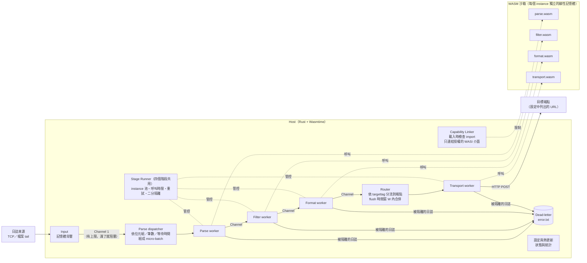

# WCM Log Forwarder

以 WebAssembly Component Model（WCM）為插件架構的日誌轉發器。使用者的自訂邏輯（解析、過濾、格式化、傳送）以 WebAssembly 元件的形式插入；即使插件陷入無窮迴圈、崩潰或試圖越權存取，轉發也不會中斷，重要的日誌也不會遺失或外流。

## 摘要

現有的日誌轉發器（Fluent Bit、Fluentd、Vector）允許使用者以 Lua、Ruby 或 WASM 插入自訂邏輯，但有兩個共同的問題：

1. **插入的邏輯可能阻塞整個轉發**：邏輯若不回傳，例如陷入無窮迴圈或耗盡記憶體，轉發會停住或程序被終止，造成重要日誌遺失。
2. **插入的邏輯不符合最小權限原則**：自訂邏輯與轉發器共用同一個程序的權限，可以讀檔、讀環境變數、對外連線，有資訊外流的疑慮。

本系統利用 WebAssembly 的沙箱隔離與跨語言特性，以及建立在其上的 WebAssembly Component Model，建立日誌轉發器的框架來解決這兩個問題：

- 每次插件呼叫都有時限，逾時或崩潰時只隔離造成問題的那一筆。
- 每個處理階段只取得它需要的能力，未授權的存取在載入時就被拒絕。

實驗中，五個產品在相同資源（1 CPU、512 MiB）與相同處理邏輯下轉發 1 KiB 的 JSON 日誌：

- **吞吐量**：本系統的最大可持續吞吐量約 25,000 筆／秒，次於 Fluent Bit Lua 與 Fluentd Ruby，約為同樣以 WASM 插入邏輯的 Fluent Bit WASM 的 5.7 倍。
- **延遲**：本系統與 Fluent Bit、Fluentd 相當，沒有明顯升高。
- **故障**：插件陷入無窮迴圈時，其他四個產品都停止轉發；本系統數秒內恢復，只隔離那一筆日誌。

這些結果顯示，本系統能在安全性與效能之間取得平衡，適合流量中低、重視資料完整與資料安全的場景。

> 吞吐量與延遲的數字來自先前版本的正式量測（2026-10）；以目前的 `core/` 重新量測的腳本在 [`experiment/`](experiment/README.md)，重測後請以新數字更新本節與[成果](#成果)。

## 系統架構



### Host 的職責

Host 是以 Rust 撰寫的程序，嵌入 Wasmtime 執行插件。所有與可靠性、安全性有關的機制都在 Host，插件不需要處理：

| 職責 | 作法 |
|---|---|
| 輸入與背壓 | 以 TCP 或檔案 tail 讀取日誌。Channel 有容量上限，下游跟不上時逐級阻塞上游；程序記憶體接近 cgroup 上限時暫停讀取，不斷線、不丟資料 |
| 批次 | Parse dispatcher 依位元組上限（預設 128 KiB）、筆數上限或等待上限組成 micro-batch，一次呼叫處理一批 |
| 呼叫時限 | 每次插件呼叫前設定 epoch deadline，超過 `stage_timeout_ms` 就中止這次呼叫 |
| 記憶體上限 | 每個 instance 的線性記憶體有上限（`mem_limit_mb`），超過時配置失敗並 trap，不影響 Host 與其他 instance |
| instance 管理 | 每個階段維持一個預熱的 instance 池。trap 或逾時的 instance 直接丟棄並換新；記憶體成長到上限的一半時自動換新，插件不需要自行釋放記憶體 |
| 錯誤隔離 | 一批失敗時先重試一次，再遞迴二分找出造成錯誤的那幾筆，只把它們寫入 dead-letter，其餘照常處理 |
| 能力管控 | 載入插件時檢查它 import 的 WASI 介面，未授權就拒絕載入；linker 只連結授權的介面；Transport 只能連到設定中列出的端點 |
| 傳送 | Router 依 targettag 把日誌分流到各端點，在 flush 時間窗 W 內合併成大批次。傳送失敗時以指數退避重試，用完仍失敗的資料寫入 dead-letter（at-least-once） |
| 維運 | 設定與插件熱更新、每秒狀態輸出、關閉時印出各階段統計 |

### 插件的職責

插件是 WebAssembly 元件，可以用 Rust、C、C#、Go 撰寫（見 [`plugins/`](plugins/)）。介面以 WIT 定義（[`core/wit/log_plugin.wit`](core/wit/log_plugin.wit)），每個階段一個 world，插件只需要實作一個「一批進、一批出」的函式：

| 階段 | WIT world | 插件實作的函式 | 範例插件的行為 |
|---|---|---|---|
| Parse | `parser-plugin` | `parse(list<string>) → list<parsed-entry>` | 解析 JSON，取出時間、等級、訊息與其餘欄位，決定送往哪個端點（targettag） |
| Filter | `reduction-plugin` | 回傳每一筆 keep／drop | 只保留 warn 以上 |
| Format | `format-plugin` | 回傳每一筆格式化後的 bytes | 轉成 json-flat（巢狀欄位攤平） |
| Transport | `transport-plugin` | `transport(list<bytes>)` | 以 `wasi:http` POST 到端點 |

插件看不到 Host 的檔案、環境變數與網路，除非設定中明確授權（`capabilities:`）。

## 一筆日誌的處理流程

以一筆 TCP 送入的 JSON 日誌為例：

1. **輸入**：Input 讀取一行日誌，送進 Channel 1。Channel 1 調節整個系統的流量，滿了就阻塞讀取，壓力經由 TCP 流量控制傳回日誌來源。
2. **組成批次**：Parse dispatcher 從 Channel 1 取出日誌，累積到位元組上限、筆數上限或等待上限（預設 5 ms）任一成立時，形成一個 micro-batch。
3. **呼叫插件**：Parse worker 從 instance 池取得一個 instance，設定呼叫時限，把整批送進插件，取回解析後的批次。Host 為每一筆指定 id，之後 Filter 與 Format 依相同流程呼叫各自的插件。
4. **過濾與格式化**：Filter 回傳每一筆保留或丟棄，Host 依 id 套用；Format 把保留的日誌轉成輸出格式。
5. **分流與合併**：Router 依每筆的 targettag 分到對應的端點，在 flush 時間窗 W（預設 100 ms）內合併成較大的批次。
6. **傳送**：Transport worker 呼叫 Transport 插件，把批次送到端點；失敗時重試，用完仍失敗的寫入 dead-letter。

**同步與非同步的分界**：每個階段是一條同步執行的執行緒，階段之間以有容量上限的 Channel 連接。處理完的批次送進下一個階段的 Channel 排隊，因此各階段可以同時處理不同的批次。插件呼叫本身是同步的：一次呼叫只處理一批，結束後才處理下一批。

**出錯時**：任何一個階段的插件呼叫失敗（回傳錯誤、trap、逾時、記憶體超限）時：

1. 若是 trap 或逾時，丟棄該 instance。
2. 換一個新的 instance 重試一次。
3. 仍失敗時，把批次切半分別呼叫，成功的半批保留，失敗的半批繼續切，直到找出造成錯誤的那幾筆。
4. 只有這幾筆寫入 `error.txt`，其餘日誌照常往下游送。

## 五個設計模式

系統的核心機制整理成五個設計模式。前兩個處理「以 WASM 插件處理資料流時的效能」，後三個處理「插件不可信時的可靠性與安全性」。

### 1. Amortized Boundary Crossing（攤提跨邊界的固定成本）

- **問題**：每次 Host 呼叫 WASM 插件都有固定成本，例如參數在 Host 與沙箱之間的複製、instance 的狀態切換。若每筆日誌呼叫一次，固定成本會主導處理時間。
- **作法**：一次呼叫處理一批日誌，以批次大小攤提固定成本。批次上限以**位元組**為主（預設 128 KiB），而不是筆數：攤提的效果取決於每次呼叫處理的位元組數，以位元組為上限時，不同大小的日誌都能落在效率平緩的區間。
- **位置**：Parse dispatcher（`core/src/pipeline/parse.rs`），設定 `batch.micro_batch_max_bytes_kib`、`micro_batch_records`、`micro_batch_max_wait_ms`。
- **效果**：每次呼叫 1 筆時，飽和處理量低於 4,500 筆／秒；每次呼叫 256 筆時為 25,000 筆／秒（先前版本的正式量測）。以目前版本試跑時也有約 3.8 倍的差距。

### 2. Streaming Micro-Batch（邊收邊處理，只緩衝輸出）

- **問題**：攤提需要批次，但若累積滿一個 flush 時間窗才開始處理，處理時間會疊加在等待時間上，延遲隨時間窗變大而增加。
- **作法**：處理端以小批次（數毫秒）邊收邊處理，只有輸出端依 flush 時間窗 W 合併。延遲約為 W 加上固定的處理時間。
- **位置**：Parse dispatcher（小批次）與 Transport router（依 W 合併），設定 `batch.max_wait_ms`。
- **效果**：W = 1 s 時，超額延遲（p99 − 0.99·W）從整批處理的 292 ms 降到 29 ms；不同 W 下超額延遲都維持在約 30–45 ms。

### 3. Watchdog and Respawn（呼叫時限與重生）

- **問題**：插件可能陷入無窮迴圈或持續配置記憶體。同一個執行緒上的呼叫不回傳，整條轉發就停住。
- **作法**：每次呼叫前設定 epoch deadline（呼叫時限 T），並限制每個 instance 的記憶體。逾時、記憶體超限或崩潰時，以 trap 中止呼叫，丟棄被污染的 instance，從預熱的池中換一個新的繼續處理。
- **位置**：`core/src/plugin.rs`（epoch 與記憶體限制）、`core/src/pipeline/runner.rs`（instance 池與重生），設定 `batch.stage_timeout_ms`、`mem_limit_mb`。
- **效果**：
  - 恢復時間隨 T 成長：T = 1／2／5 s 時分別約 4／8／20 s 恢復，只損失造成問題的那一筆。
  - 關閉時限時，parse 永久停住，之後的日誌全部無法送達。
  - 時限機制本身的 CPU 成本約 10%（試跑結果）。

### 4. Poison Record Bisection（遞迴二分隔離壞資料）

- **問題**：插件介面是「一批進、一個結果出」，批次中只要有一筆造成錯誤，Host 只知道整批失敗。整批丟棄會讓正常的日誌連帶遺失。
- **作法**：Host 把失敗的批次遞迴切半重新呼叫，成功的半批保留，失敗的半批再切，直到單筆為止；只有造成錯誤的資料寫入 dead-letter。trap 類的錯誤每次探測都可能耗掉整個時限，所以另外限制探測次數與深度，並隨區段變小縮短探測時限。
- **位置**：`core/src/isolation.rs`（二分邏輯）、`core/src/pipeline/runner.rs`（四個階段共用）。
- **效果**：
  - 壞資料佔 0.1%–20% 時，正常日誌都 100% 送達，dead-letter 只有壞資料。
  - 每筆壞資料約需 5–16 次額外呼叫。
  - 關閉二分時，壞資料隨機佔 1% 就讓正常日誌只送達約 25%（試跑結果）。

### 5. Capability-Scoped Stage（各階段只取得需要的能力）

- **問題**：插件若取得與 Host 相同的權限，就能讀取檔案、環境變數中的金鑰，或把日誌送到任意位址。
- **作法**：每個階段各自建立 linker，只連結該階段被授權的 WASI 介面：
  - 預設不給檔案系統、網路與環境變數。
  - Transport 只能以 `wasi:http` 連到設定中列出的端點。
  - 載入時讀取插件 import 的介面，有未授權的介面就拒絕載入。
  - 若插件只是因為工具鏈連帶 import 了介面，可以授權為 `inert`：介面存在，但不給任何目錄或連線。
- **位置**：`core/src/capability.rs`，設定 `capabilities:`。
- **效果**：
  - 未授權時，插件在載入時就被拒絕，不到 1 秒。
  - 授權為 inert 時，四個階段讀檔、讀環境變數、連線全部失敗。
  - 只有 Transport 能連到設定的端點；未列出的連接埠沒有收到任何連線。

## 成果

### 系統的特點

- **插件出錯不中斷轉發**：無窮迴圈、崩潰、越界、記憶體爆量都只影響造成問題的那一筆，服務持續運作。
- **日誌不遺失**：被隔離的日誌與送不出去的日誌都寫入 dead-letter，可以事後檢查與補送。
- **最小權限**：插件預設沒有任何檔案、網路與環境變數的存取權，越權在載入時就被拒絕。
- **跨語言**：同一組 WIT 介面可以用 Rust、C、C#、Go 撰寫插件，Host 不需要修改。
- **插件開發簡單**：插件只實作「一批進、一批出」的函式；時限、重試、隔離、記憶體回收都由 Host 負責。

### 是否解決問題

| 問題 | 現有轉發器的表現 | 本系統 |
|---|---|---|
| 插入的邏輯陷入無窮迴圈 | Fluent Bit（Lua、WASM）、Fluentd、Vector 全部停止轉發 | 約 7 秒後恢復（時限 T = 2 s），只隔離那一筆 |
| 插入的邏輯持續配置記憶體 | Fluent Bit（Lua、WASM）與 Vector 被 OOM 終止；Fluentd 的 worker 被終止後停止轉發 | 該 instance 達到記憶體上限後中止，只隔離那一筆 |
| 插入的邏輯拋出例外 | 五個產品都能繼續運作 | 只隔離那一筆 |
| 插入的邏輯讀取檔案、環境變數、對外連線 | 與轉發器共用程序權限，沒有限制 | 未授權時拒絕載入；授權為 inert 時所有嘗試都失敗；Transport 只能連到設定的端點 |

故障的比較以目前版本量測（每秒 2,000 筆、60 秒，第 15 秒送出一筆觸發故障的日誌，每種情況 1 次）。

### 效能

五個產品使用相同的資源與處理邏輯：

- **資源**：每個產品一個 Docker 容器，1 CPU、512 MiB、不允許 swap。
- **處理**：解析 JSON → 只保留 warn 以上 → 輸出 json-flat → HTTP POST。
- **條件**：1 KiB／36 欄位的 JSON 日誌，flush 時間窗 W = 0.1 s。

| 產品 | 自訂邏輯 | 最大可持續吞吐量（筆／秒） | p99 延遲（5,000 筆／秒） |
|---|---|---|---|
| Fluent Bit 5.0.9 | Lua | 58,500 | 117 ms |
| Fluentd 1.16 | Ruby | 36,500 | 128 ms |
| **WCM（本系統）** | **WebAssembly Component** | **25,000** | **140 ms** |
| Vector 0.49.0 | VRL | 11,750 | 163 ms |
| Fluent Bit 5.0.9 | WASM | 4,400 | 143 ms（4,000 筆／秒） |

- 吞吐量次於以直譯語言插入邏輯的 Fluent Bit Lua 與 Fluentd，約為同樣使用 WASM 的 Fluent Bit WASM 的 5.7 倍。
- 延遲由 flush 時間窗主導，本系統與 Fluent Bit、Fluentd 相當。
- 以上為先前版本的正式量測（WSL2，延遲已校正時鐘跳動）。以目前版本試跑時，W = 0.1 s 的 p99 為：本系統 125 ms、Fluent Bit Lua 116 ms、Fluentd 126 ms，趨勢一致。

### 適用場景與限制

- **適合**：流量中低（單核數萬筆／秒以內）、插件由第三方或不同團隊提供、日誌含敏感資訊而需要限制插件存取的場景。
- **代價**：沙箱、呼叫時限與跨邊界的資料複製使吞吐量低於 Fluent Bit Lua 與 Fluentd；需要極高吞吐量時，應以多個實例水平擴充。
- **語意**：傳送為 at-least-once。逾時或崩潰時無法確定端點是否已收到，重送可能造成重複。
- **故障隔離的時間**：卡住的呼叫要等到時限才中止，所以時限 T 越長，恢復越慢（約 2T 到 4T）。T 要依插件正常的處理時間設定。

## Repo 結構

| 目錄 | 內容 | 說明 |
|---|---|---|
| [`core/`](core/README.md) | 轉發器本體（Rust + Wasmtime）與編譯好的範例插件 | 建置、設定、錯誤處理 |
| [`plugins/`](plugins/README.md) | Rust、C、C#、Go 的範例插件，固定版本的工具鏈，從零建置與驗證 | 如何開發插件 |
| [`experiment/`](experiment/README.md) | 五產品比較（吞吐量、延遲、突發、故障）與五個設計模式的實驗，全部以 Docker 重現 | 實驗方法與重現步驟 |
| [`demo/`](demo/README.md) | 三個展示腳本：正常轉發、無窮迴圈、越權存取 | 只需要 Docker |

## 快速開始

最快的方式是執行 demo，只需要 Docker：

```bash
cd demo
./setup.sh                       # 由 core/ 建置映像（第一次約數分鐘）
./01_normal_forwarding.sh        # 正常的轉發流程
./02_infinite_loop.sh            # 插件陷入無窮迴圈：暫停數秒後恢復，只隔離那一筆
./03_capability_violation.sh     # 插件越權：載入時拒絕、執行時擋下
```

直接建置與執行轉發器見 [`core/README.md`](core/README.md)，開發插件見 [`plugins/README.md`](plugins/README.md)。
